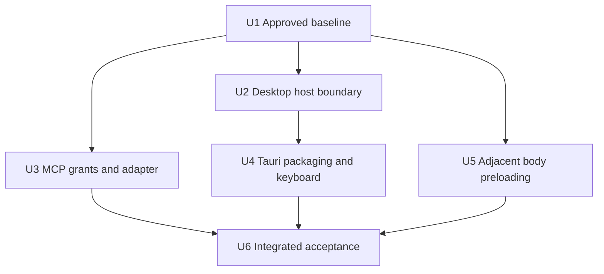
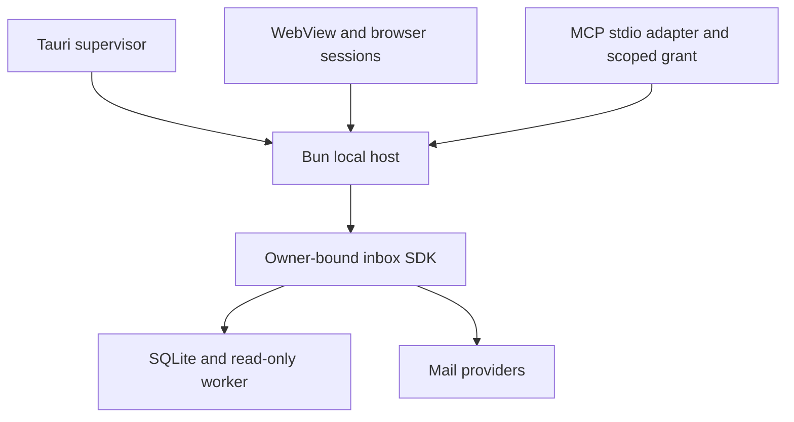

# Personal desktop mail with MCP and instant navigation

## Summary

Integrate current upstream into the personal Exchange/IMAP fork, preserve its existing SQLite mail engine, add a Tauri desktop shell and read/write MCP adapter, and complete keyboard-first workflows with bounded adjacent-email body preloading.

---

## Problem Frame

The user wants a personal Superlocal fork that feels as responsive and keyboard-driven as Superhuman and is accessible to agents. They confirmed Tauri (the original request said “Tory”), read/write MCP, and integration of upstream while preserving Exchange support. Planning stays with the coordinator; bounded implementation should use smaller models where available.

---

## Requirements

- R1. Use existing `jasonappah/superlocal` fork; preserve Microsoft 365 IMAP OAuth, refresh/offline access, and SMTP behavior while integrating approved upstream.
- R2. Provide locally configured MCP reads and writes through existing authorized SDK operations, with durable receipts, conditional revisions and accurate queued/sent distinctions.
- R3. Deliver a locally runnable Tauri desktop app with embedded persistent storage, independent of a source checkout or system Bun at runtime.
- R4. Preserve upstream Superhuman shortcuts and make core navigation, search, compose/reply, selection, triage, Undo, settings and shortcut discovery keyboard-accessible.
- R5. Warm adjacent email bodies so valid cached navigation avoids body requests; respect bounded resources, focus, scope and image policy.
- R6. Verify current-baseline fictional-mail UI evidence and existing correctness/performance contracts. Publish review branches/PRs to the fork; obtain approval before merge/deployment.

---

## Context & Research

- Starting checkout/fork main: `d29f256`; Exchange commits `ed43746`, `07f2fb1`, documentation `d29f256`.
- Fetched upstream main: `d3725bc`, 118 commits ahead of the common baseline. User approved integrating this history on an isolated branch. Current checkout was clean; `data/runtime/services.json` was absent, so running-build identity remains unverified.
- Upstream PR #27 already adds Superhuman navigation; retain it instead of duplicating it. Demand-driven metadata paging is already present; body preloading is not.
- SQLite already lives in `packages/inbox-sdk/src/core.ts`; no PostgreSQL migration is needed. `apps/local-host/src/runtime.ts` owns persistence and instance keys.
- Existing body caching/deduplication lives in `apps/web/src/inbox.ts`, with an 8 MiB window body cache. Its foreground loader publishes models/errors, so speculation needs distinct admission behavior.
- Upstream `packages/inbox-sdk/src/correspondence-worker.ts` is resolved through Bun at runtime; packaging must exercise that worker outside the checkout.
- `apps/local-host/src/application-auth.ts` uses browser sessions and rejects bearer headers. MCP authentication must be a separate explicit boundary.
- Exchange registration must adopt upstream provider descriptors while retaining its OAuth email field; generic descriptor generation currently omits fields for OAuth providers.
- No `docs/solutions/` or matching requirements document was present. Relevant historical guidance: `unified-inbox-decisions.md`, `imap-provider-review.md`, `docs/ui-prs/reader-arrow-navigation/review.md`, `docs/ui-prs/fast-inbox-startup/review.md`, `docs/qa/shortcuts/README.md` (upstream).

---

## Key Technical Decisions

| Surface | Decision | Rationale |
| --- | --- | --- |
| Storage | Retain Bun SQLite and SDK ownership | Already embedded; replacing it adds migration risk without serving the request |
| Desktop | Tauri v2 Rust supervisor plus compiled Bun host; macOS current architecture first | Reuse mail engine and qualify the user's platform before claiming other installers |
| UI boundary | Host serves optimized UI/API on loopback; no renderer-native IPC capabilities | Preserve browser behavior and keep mail frames away from native privileges |
| MCP | Stdio process attaches to the running host using an independently revocable owner-bound grant | Avoid duplicate database owners; protocol adapter cannot bypass SDK policy |
| Preload | Data-only next-two/previous-one within the existing visible window | Remove body latency without hidden DOM rendering or speculative tracking requests |
| Keyboard | Audit and fill gaps in upstream intent resolver and command UI | One mapping system avoids native/web conflicts |

Desktop close hides the window and keeps the owned host available; explicit Quit gracefully stops only its owned host. Reopen focuses the existing instance. Do not attach to unidentified processes or open a second writer for a profile. MCP reports host unavailable when the host is stopped; it never spawns a host. Local app distribution is the initial target; signing/notarization depends on available user credentials and must not be falsely claimed.

Desktop startup passes an ephemeral bootstrap secret over inherited process communication, exchanges it once for a WebView session, and keeps reusable credentials out of URLs. OAuth opens the system browser; a short-lived single-use state binds callback completion to the initiating desktop owner without assuming shared browser cookies. Preserve provider redirect validation and client registration requirements rather than weakening them for arbitrary ports.

Initial desktop bootstrap supports local-auth profiles only; restricted Google-auth profiles reject bootstrap explicitly rather than mapping a desktop secret to a verified user. MCP grant issuance cannot create owners; host-owned owner eligibility is shared with browser authorization and rechecked per request. Desktop provider OAuth uses narrowly scoped attempt-specific handoff routes: an authenticated desktop creates a one-use authorization ticket, the external browser exchanges it for its attempt cookie, and callback validation retains that cookie, PKCE, state, provider registration and reconnect generation. Ordinary browser authorization is unchanged. Test the complete flow using separate browser/WebView cookie jars, including owner removal during consent.

The host must hold an OS-released exclusive profile lock before database initialization. PID files are diagnostics, not ownership. Parent-channel EOF triggers bounded shutdown; the supervisor escalates only for its owned child after a deadline. Package acceptance includes supervisor death, hung/crashed read worker, interrupted quit and concurrent relaunch. Preserve read-only worker protocol and uncertain-send recovery; never blindly resend after a crash.

Desktop profile adoption is explicit: accept an existing private configuration path, resolve its data paths relative to that configuration, and retain the same instance identity, keys and databases in place. Never silently relocate mail or regenerate missing identity files. A fresh profile is explicitly distinguished from adoption. Validate paired runtime/auth files before startup; fictional acceptance covers missing keys, occupied profile and launching after the source checkout is unavailable. Host failure presents a keyboard-accessible disconnected state with Retry; preserve unsaved composer text and reconcile durable receipts before re-enabling mutation controls. Retry restarts only the owned host and reconnects without discarding renderer state.

MCP grants are provisioned/revoked by a local administrative CLI tied to the existing private profile, stored hashed, scoped to an owner and instance, and checked on every request. Read/write grants cannot override existing provider write gates or restricted-install owner eligibility. Grant provisioning never runs at MCP startup. Browser session authentication remains separate. Secrets go only to private local configuration, not logs or repo files.

MCP inventory covers bounded mailbox/search/thread/message reads, operation status, explicit read/star updates, Done/reminder/Undo, draft create/edit and enqueue-send where supported. Owner identity is never a tool argument. Return canonical IDs, revisions, cursors/truncation and durable receipt state. Repeated idempotency keys preserve operation identity; conflicting payloads fail. Email content is untrusted data, not agent instructions.

---

## Scope Boundaries

- No database replacement, generic SQL/shell tools, remote public MCP hosting, new mail provider, or renderer rewrite.
- No new test files/frameworks/CI; extend the six existing suites only.
- No automatic merge, live-account sending, or deployment. Real mailbox data is not a test fixture.

### Deferred to Follow-Up Work

- Cross-platform installers and public signed/notarized distribution after the local macOS package is qualified.

---

## Implementation Units

### U1. Integrate approved upstream and preserve Exchange

**Goal:** Establish the current-app review baseline before feature implementation.
**Requirements:** R1, R4, R6. **Dependencies:** None.
**Files:** `apps/local-host/src/providers.ts`, `apps/local-host/src/config.ts`, `apps/web/src/ProviderConnections.tsx`, `apps/web/src/App.tsx`, `apps/web/src/host.ts`, `README.md`; tests `packages/inbox-sdk/tests/api.test.ts`, `packages/inbox-sdk/tests/provider.test.ts`.
**Approach:** Isolated branch/worktree from fork main. Before any UI integration edits, recheck refs, identify any active services, establish current fictional baseline evidence and open the draft UIPR required below. Then integrate approved upstream without rewriting existing history. Reconcile descriptors rather than retaining obsolete onboarding registration. Preserve OAuth email field end-to-end, callback relay, offline access and refresh behavior. Keep fork main untouched.
**Patterns to follow:** Upstream descriptor-based provider registry and existing Microsoft OAuth tests.
**Test scenarios:** Exchange descriptor renders/requires email; OAuth initiation/callback/reconnect retain state and offline-access checks; missing or malformed email fails; other provider descriptors remain valid; existing Microsoft refresh regression remains covered.
**Verification:** Combined source builds and required suites pass; integrated revision recorded. Capture fictional current-fork and integrated-baseline evidence, then use the integrated baseline consistently for feature before/after evidence. Draft `UIPR: Personal desktop mail and instant navigation` must exist before UI feature edits; explain approved upstream integration separately in its body.

### U2. Desktop host lifecycle and authenticated handoff

**Goal:** Supply a packageable local host with safe desktop startup and OAuth.
**Requirements:** R1, R3, R6. **Dependencies:** U1.
**Files:** `apps/local-host/src/index.ts`, `apps/local-host/src/host.ts`, `apps/local-host/src/runtime.ts`, `apps/local-host/src/config.ts`, `apps/local-host/src/application-auth.ts`, new `apps/local-host/src/desktop.ts`; `packages/inbox-sdk/server/microsoft-oauth-api.ts`; tests `packages/inbox-sdk/tests/api.test.ts`, `packages/inbox-sdk/tests/provider.test.ts`.
**Approach:** Add explicit desktop mode with application-data paths, private instance coordination, loopback-only listener and exact origin/Host checks. Readiness communicates port and build identity privately. One-time bootstrap establishes a scoped browser session. Browser OAuth completion consumes owner-bound one-time state without requiring WebView cookies in the system browser. Existing hosted/browser behavior remains supported.
**Patterns to follow:** Runtime key binding/private permissions, application authentication, existing OAuth state validation.
**Execution note:** Characterize current session/callback behavior before changing it.
**Test scenarios:** Valid bootstrap once succeeds; replay/wrong instance/expired bootstrap fails; hostile origin cannot bootstrap; occupied profile prevents second writer; worker/startup failure yields bounded failure; OAuth completion without browser session still requires correct initiating state; cancellation, replay and cross-owner callback fail; shutdown preserves accepted durable operations.
**Verification:** Host lifecycle and OAuth handoff pass fictional integration tests; secrets never appear in readiness logs or URLs; external browser and WebView identity boundaries are demonstrably distinct.

### U3. Owner-bound MCP grants and stdio adapter

**Goal:** Expose useful mail operations without bypassing the SDK.
**Requirements:** R2, R6. **Dependencies:** U1.
**Files:** New `apps/local-host/src/mcp-auth.ts`, `apps/local-host/src/mcp-admin.ts`, `apps/mcp/package.json`, `apps/mcp/src/index.ts`, `apps/mcp/src/tools.ts`; `apps/local-host/src/host.ts`, `packages/inbox-sdk/src/client.ts`, root `package.json`, `bun.lock`; tests `packages/inbox-sdk/tests/api.test.ts`, `packages/inbox-sdk/tests/provider.test.ts`.
**Approach:** Separate authenticated MCP API mount with explicit operation allowlist, bounded inputs/results and per-request grants. Wrap existing SDK client/receipts; avoid reimplementing mutation semantics. Use official MCP SDK stdio transport with verified published version compatibility; stdout is protocol-only. Attach to configured loopback endpoint and verify instance binding; shutdown releases adapter only.
**Patterns to follow:** SDK HTTP validation, owner-bound clients, durable receipt/draft revision tests.
**Test scenarios:** Cross-owner and wrong-instance grant denied; revoked grant and disallowed write denied; browser session auth unchanged; bounded search pagination and truncation; conditional draft conflict; same-key retry returns same receipt while changed payload fails; disconnect after enqueue causes no duplicate send; unsupported provider action remains unsupported; real stdio initialize/list/call roundtrip and EOF cleanup preserve host lifetime.
**Verification:** Fictional MCP client reads, updates and enqueues supported operations with UI-visible bounded deltas; errors distinguish conflict, unavailable, queued and uncertain outcomes. Document CLI provisioning/revocation and client configuration without real secrets.

### U4. Tauri package and keyboard completeness

**Goal:** Run the existing mail UI as a self-contained keyboard-first desktop app.
**Requirements:** R3, R4, R6. **Dependencies:** U2.
**Files:** New `apps/desktop/package.json`, `apps/desktop/src-tauri/Cargo.toml`, `apps/desktop/src-tauri/build.rs`, `apps/desktop/src-tauri/tauri.conf.json`, `apps/desktop/src-tauri/src/main.rs`, `scripts/build-desktop.ts`; `package.json`, `apps/web/src/mail-shortcuts.ts`, `apps/web/src/shortcuts.ts`, `apps/web/src/MailCommandDialog.tsx`, `apps/web/src/App.tsx`; tests `apps/web/tests/mail-shortcuts.test.ts`, `packages/inbox-sdk/tests/api.test.ts`.
**Approach:** Compile target-specific Bun sidecar plus correspondence worker/assets; disable environment-file autoload and sanitize runtime override environment. Rust owns process lifecycle, drains logs, validates readiness and restricts navigation. Localhost UI receives no native capabilities. Retain scriptless iframe. External permitted links open system browser. Build a keyboard coverage matrix and fix demonstrated gaps using existing intents/help, including settings access and native menu collisions.
**Patterns to follow:** Optimized existing UI build, upstream shortcut resolver/editing guards, existing command dialog.
**Test scenarios:** Installed app launches and uses worker without checkout/system Bun; quit/reopen retains fictional mail; second launch focuses same instance; host crash shows recoverable state; unknown external navigation denied; email iframe cannot invoke native commands; keyboard navigation/search/reply/triage/Undo/settings/help work with actual native key events; composer, IME, modifier, modal and iframe focus do not trigger unintended actions.
**Verification:** Local macOS package inspected and exercised, with matching fictional before/after media and recordings for interaction. Any signing or native toolchain blocker is reported rather than claiming a runnable package from source-only checks.

### U5. Bounded adjacent-body warming

**Goal:** Make cached next/previous navigation immediate without observable speculative side effects.
**Requirements:** R5, R6. **Dependencies:** U1.
**Files:** `apps/web/src/inbox.ts`, `apps/web/src/App.tsx`; tests `apps/web/tests/mail-model.test.ts`, `packages/inbox-sdk/tests/api.test.ts`.
**Approach:** Separate speculative cache admission from foreground model/error publication. Schedule next two/previous one from current bounded navigation order only, concurrency one; never fetch extra metadata to fill the queue. Deduplicate/promote shared loads for foreground work. Preserve 8 MiB cap, protect displayed bodies, skip oversized speculative bodies and bound queued work. Invalidate queued work on scope, policy, content or navigation generation changes; late replies must pass all fences. Do not mark read, render hidden HTML, fetch assets/attachments, or publish replacement models during speculation.
**Patterns to follow:** Existing cached-detail validation, body epochs, affected-thread reconciliation, pinned reader and bounded navigation accessors.
**Test scenarios:** Adjacent cached open issues zero body requests and retains unaffected identities; open during prefetch shares work; rapid reversal and account/policy switch reject stale completions; empty/end-of-window does not expand metadata; oversized body does not evict displayed body; background failure is silent and later foreground retry works; rapid Done/Undo plus incoming reply preserves captured membership and newest focus; no speculative asset requests.
**Verification:** Optimized paired base/head measurements meet existing cached-open target and do not regress startup/triage budgets. Separate first-body latency, cache-hit navigation, iframe layout and animation costs.

### U6. Integrated acceptance and handoff

**Goal:** Demonstrate all surfaces work together on the approved baseline.
**Requirements:** R1–R6. **Dependencies:** U3, U4, U5.
**Files:** `README.md`, new `docs/ui-prs/personal-desktop-mail/review.md`; existing tests `packages/inbox-sdk/tests/api.test.ts`, `packages/inbox-sdk/tests/provider.test.ts`, `apps/web/tests/mail-model.test.ts`, `apps/web/tests/mail-shortcuts.test.ts`, `apps/web/tests/quick-replies.test.ts`, `apps/web/tests/storage.test.ts` as relevant.
**Approach:** Complete required typecheck/build/web/API suites once at integrated head, targeted checks during units. Exercise concurrent UI/MCP actions with fictional mail. Capture reviewable before/after media against the integrated baseline with equal settings, viewport, fixtures and optimized build identity. Run code review/autofix, browser pipeline testing, fork PR publishing and CI watch. Keep PR draft until evidence/checks complete; no self-approval/merge/deployment.
**Test scenarios:** MCP mutation reconciles into desktop without full refresh; UI/MCP conflicting draft and Undo actions reject stale intent; queued send survives adapter disconnect; OAuth reconnect and body-policy change invalidate caches correctly; packaged offline reopen and host failure recovery preserve state.
**Verification:** Report revisions, runtime/browser/hardware, counts and fixture seed, logging state, warmup/cache conditions, at least five samples with median/p95/max for ~6.5k and 50k messages; cached open ≤100ms, E/W ≤150ms, startup ≤1.5s at ~6.5k–10k and ≤4s at 50k. Do not substitute smaller fixtures or hide preexisting failures. PR contains accessible fictional media, test results, implementation commit hashes and durable residual findings.

---

## System-Wide Impact

This illustrates the intended approach and is directional guidance for review, not implementation specification.

Authentication is per entry point; mail authorization remains SDK-owned. Cancellation of a caller does not cancel durable mutations. Speculative failures do not become foreground errors. Desktop shutdown owns only its child and preserves operations for recovery. Existing server sanitization, scriptless frames, image policy and bounded delta contracts remain authoritative across all surfaces.

---

## Risks & Open Questions

- **Packaging viability:** Compiled worker resolution must be tested early in U4; build success alone is insufficient. Retain standalone worker resource if bundling cannot preserve resolution.
- **OAuth registrations:** Preserve configured Microsoft redirect validation; document required desktop registration. Real-provider consent requires the user's credentials and is not simulated as verified live delivery.
- **Baseline evidence:** Before any UI integration edits, establish current fictional baseline and draft UIPR. If required `personal-design` skill or publishable evidence path is unavailable, stop for the mandated exception rather than bypassing repo rules.
- **Upstream semantics:** Audit optimistic Done versus durable receipt before reusing it for MCP; accepted UI intent must not be labeled durable/sent prematurely.
- **Toolchain/signing:** Discover installed Rust/Xcode/Tauri prerequisites during execution; qualify current macOS architecture, disclose unsupported distribution targets.
- **Concurrency/delegation:** Use independent worktrees after U1 for MCP and prefetch; serialize shared host/auth integration and coordinator commits. Smaller-model assignments stay bounded; coordinator reviews integration/security-sensitive changes.
- **Deferred execution details:** Exact helper names, tested MCP SDK release and worker bundling mechanism are selected against actual installed/published packages during implementation, with contract tests.

---

## Sources & References

- `AGENTS.md`, `packages/inbox-sdk/README.md`, `.github/pull_request_template.md`.
- Upstream PR #27 (keyboard), #21/#20 (demand-driven inbox); approved revisions above.
- Tauri v2: https://v2.tauri.app/develop/sidecar/ and https://v2.tauri.app/security/capabilities/ and https://v2.tauri.app/security/csp/.
- Bun standalone executables: https://bun.sh/docs/bundler/executables.
- MCP SDK: https://ts.sdk.modelcontextprotocol.io/ ; authorization: https://modelcontextprotocol.io/specification/latest/basic/authorization.
- Browser cancellation: https://developer.mozilla.org/en-US/docs/Web/API/AbortController/abort ; srcdoc isolation: https://developer.mozilla.org/en-US/docs/Web/API/HTMLIFrameElement/srcdoc.
