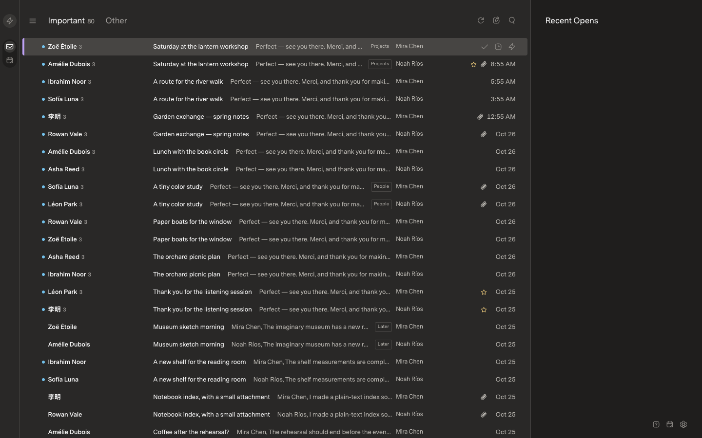
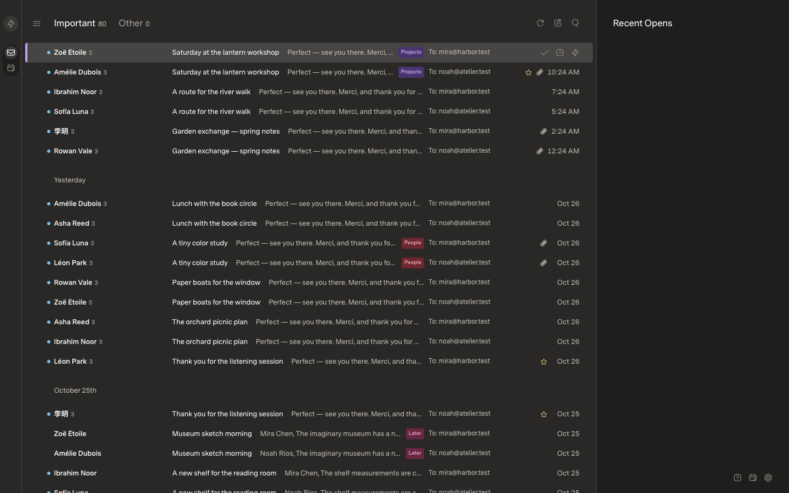
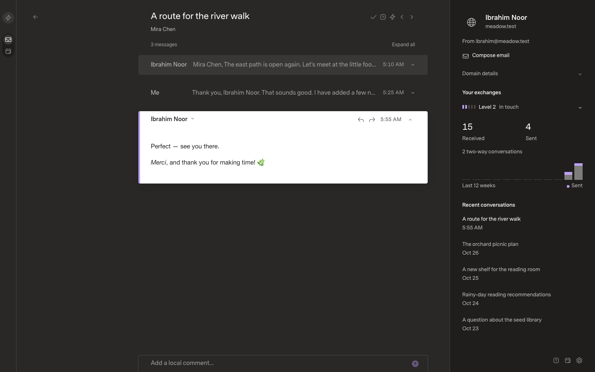
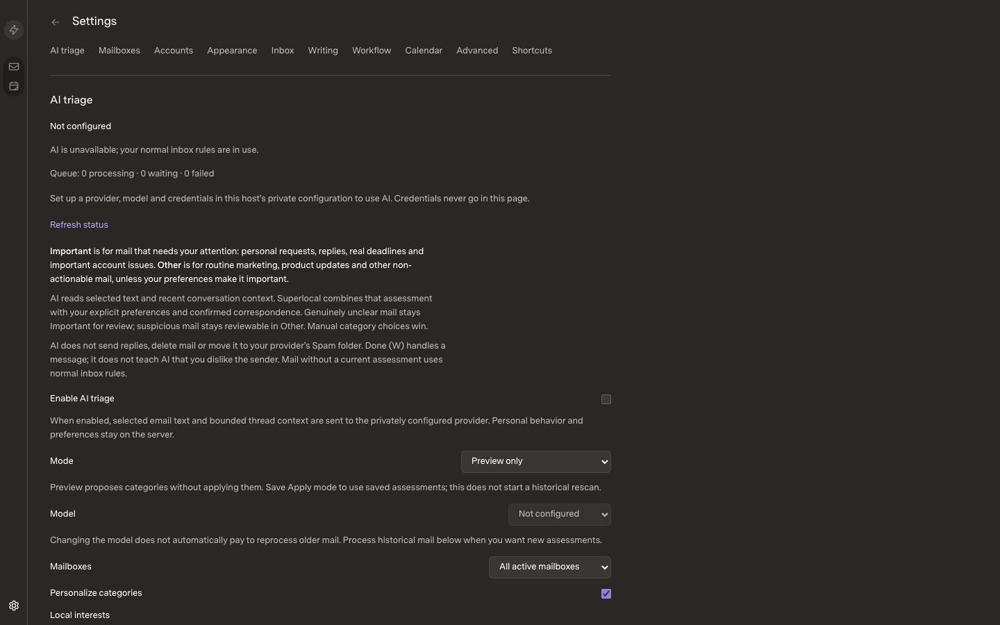
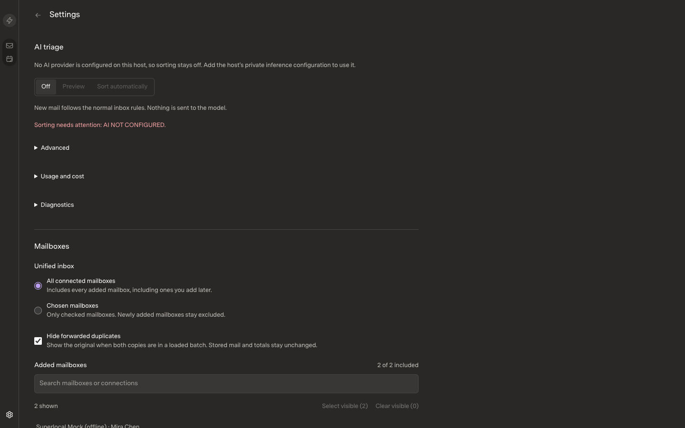
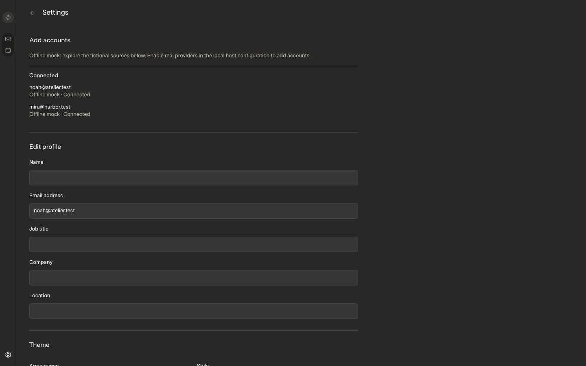
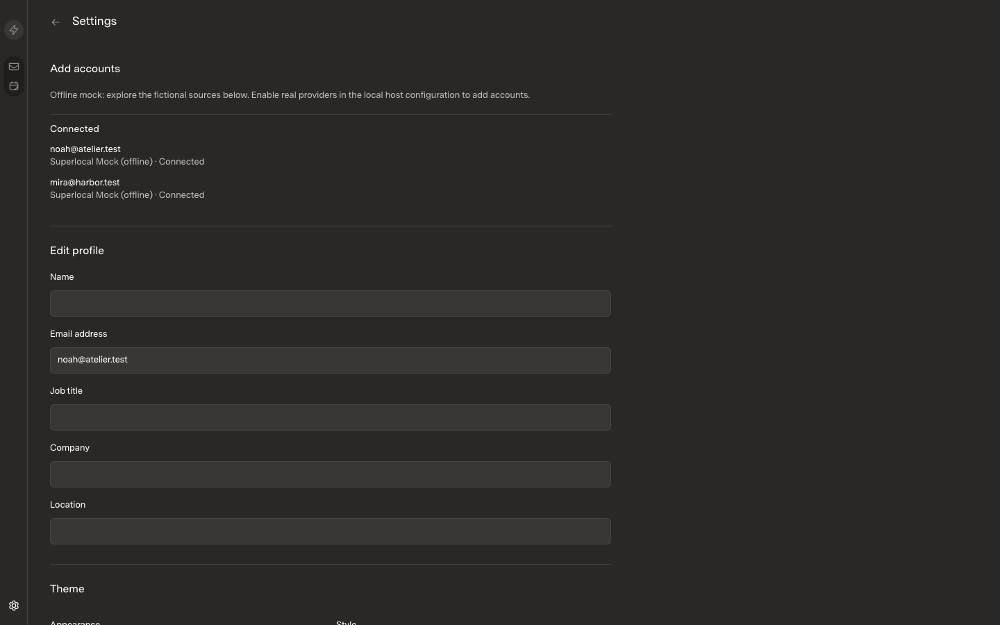

# Personal desktop mail — integration baseline review

**Reviewer-required change classification:** UIPR — the merge integrates upstream work that visibly changes the inbox list rows and the Settings area.

## Scope

- **Change and reason:** Merge upstream `origin/main` (`d3725bc`) into the personal fork baseline (`d29f256`, `feat/personal-desktop-mail`, merge commit `fa0323e`), preserving the fork's local Microsoft 365 / Exchange IMAP OAuth provider as a host-owned `exchangeImap` config key and a descriptor-form registration. This is the foundation branch for the later desktop-side units (Tauri shell, read/write MCP server, Superhuman-class keyboard UX, bounded prefetch); those units will be separately reviewed.
- **Review base / before commit:** fork `d29f256` (branch point, served UI captured port 5181)
- **Candidate / after commit:** `feat/personal-desktop-mail` at `236747b` (merge `fa0323e` + test-stability fix, served UI captured port 5182)
- [x] UIPR — visible UI can change (upstream list-row and Settings redesign)
- [ ] Non-UI only

## Before and after

Paired captures from two isolated first-run instances, each serving its own fictional offline-mock mailbox seed and its own temporary config/data directory. Both captures are the optimized `start` build (no HMR), same fresh-profile defaults, no appearance or density settings touched, 1440×900, DPR1, 100% zoom, dark theme.

| Scenario | Before (fork `d29f256`) | After (merge `fa0323e` + `236747b`) |
| --- | --- | --- |
| Inbox Important list |  |  |
| Conversation reader (same fictional thread) |  |  |
| Settings · AI triage |  |  |
| Settings · Accounts (Add accounts) |  |  |

- Fixture seed: the shipped two-mailbox fictional offline mock (`noah@atelier.test`, `mira@harbor.test`), first-run seed initiated at capture time. Row timestamps therefore differ between the two captures (each seed starts at its own wall clock); subjects, senders and counts are the same fixture.
- Viewport/zoom/theme/density: 1440×900, 100%, dark, clean first-run defaults on both sides.
- Expected visible differences (from upstream, intended):
  - Inbox list rows gain date group headers, a `To:` recipient column, and filled/colored label chips; the row template is otherwise the same information.
  - Settings · AI triage is restructured (segmented Off/Preview/Sort control, Advanced / Usage and cost / Diagnostics sections; unconfigured wording). Accounts rows now read `Superlocal Mock (offline)` instead of `Offline mock`.
  - Conversation reader, keyboard shortcuts and the command palette are unchanged in layout.
- Edge states: covered by regression suites rather than new UI states in this unit; the subsequent feature units will capture loading/empty/error/focus states as they introduce them.

## Performance and correctness

- Commands/checks: `bun --no-env-file run typecheck` (pass), `bun --no-env-file run build` (pass), `INBOX_TEST_LIVE=false bun --no-env-file run test:api` — **359 pass / 0 fail**, `bun --no-env-file run test:web` — **98 pass / 0 fail**.
- Test-infrastructure fixes in `236747b` (assertions unchanged):
  - `api.test.ts` now derives `TEMP_ROOT` from `os.tmpdir()` and creates it lazily, instead of a hardcoded foreign-machine path that made the API suite fail on every non-author machine.
  - Eight upstream tests whose 45-day Important-window check silently depended on the wall clock being within 45 days of their `EPOCH` fixtures are pinned to a synthetic clock; from 2026-10-16 onward they would otherwise fail on their own.
  - `credentialsFor` accepts declared descriptor fields for OAuth providers that have them (the local Exchange provider's email address), preserving upstream's exact field-free contract for everyone else. Caught by the restored fork regression test.
- Performance impact: none introduced — no query, reconciliation, caching, selector, virtualization or rendering logic changed by this merge beyond upstream's own reviewed work; dedicated budget measurements belong to the later feature units that touch those paths.
- Build mode/hardware/runtime: optimized `start` build, Bun 1.4.0, Chromium (CDP) headless at 1440×900, macOS arm64, SQLite-backed, cold first-run seeds.

## Review gate

- [x] The branch contains only the intended work: the approved upstream merge plus test-infrastructure stability fixes (plan document was committed alongside the merge).
- [x] Matching before/after evidence attached, fictional offline-mock data only.
- [x] Published media contains no real mail, credentials, private browser chrome or private logs.
- [x] Relevant regressions pass; no budget or check was weakened.
- [x] Unexpected UI differences: all visible deltas are upstream's own redesigns, enumerated above; the Conversation reader is unchanged.
- Reviewer / approval link: **pending — draft PR on the fork, approval required before any merge/deploy step.**
